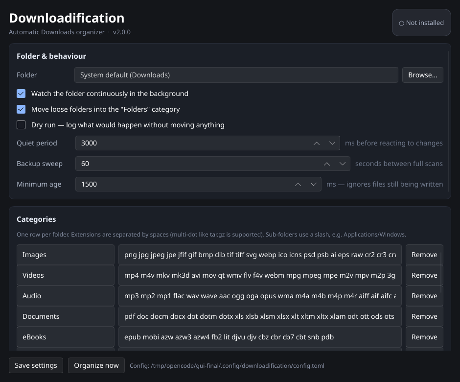

# 📁 Downloadification

> Automatically organize your Downloads folder into tidy, categorized folders — now written in Rust, with a graphical control panel and a headless daemon.

[](https://github.com/ArthurSimin/Downloadification/actions/workflows/ci.yml)
[](LICENSE)



## Highlights

This is a ground-up rewrite. The old Bash + PowerShell scripts are gone.

- **Written in Rust.** One codebase, native binaries for Linux, macOS and Windows.
- **A real GUI instead of an installer script.** The graphical control panel edits the config and installs the background service for you. **On Windows there is no PowerShell to run** — download the `.zip`, launch `downloadification-gui.exe`, click *Install service*.
- **Way more formats.** 23 built-in categories and 661 extensions, including multi-dot archives (`tar.zst`), ebooks, subtitles, ROMs, certificates, CAD, fonts, virtual machines and more.
- **It actually keeps up.** A continuous filesystem watcher with debounce **plus** a periodic full sweep, so a dropped event or a file that was still downloading can never be permanently forgotten.
- **Loose folders are organized too.** Drop a folder into Downloads and it moves into `Folders/`. The category folders Downloadification manages are never touched.
- **Safer moves.** Cross-filesystem moves fall back to copy-then-delete, in-progress downloads are detected and skipped, and duplicates become `name (1).ext`.
- **Everything is testable.** The Windows Scheduled Task XML is built in Rust and unit-tested on Linux; CI runs the whole suite on Linux, Windows and macOS.

## Features

- **Continuous watching** — reacts within a few seconds of a download finishing.
- **Periodic sweep** — a full scan every minute as a safety net; no missed files.
- **Folder handling** — loose folders go to `Folders/`; manager folders are skipped.
- **Duplicate handling** — `photo.png` → `photo (1).png`, multi-dot safe (`arc.tar.gz` → `arc (1).tar.gz`).
- **In-progress protection** — ignores `*.crdownload`, `*.part`, `*.tmp`, `*.aria2`, `*.opdownload`, `*.!ut` and friends, plus files modified in the last 1.5 s.
- **Dry-run mode** — preview what would happen without touching anything.
- **Custom categories** — extend, replace or disable any built-in category.
- **Cross-platform service install** — systemd user unit (or XDG autostart), launchd agent, or Windows Scheduled Task.
- **A live activity feed** and a plain-text log file.
- **Heartbeat-based status** — "is it running?" works even when service-manager output is localized.

## How it works

The daemon does three things:

1. **Watches** the target folder with `notify`. Events are debounced until the folder has been quiet for `settle_time_ms` (3 s by default), so a file is not grabbed mid-write.
2. **Sweeps** the folder every `sweep_interval_secs` (60 s by default). This is the safety net: even if the OS drops a filesystem event, the next sweep catches the file.
3. **Records a heartbeat** every 5 s. The GUI and `downloadification status` use it to tell whether the daemon is alive, without parsing `systemctl`/`schtasks` output (which is localized and fragile).

Before moving anything it checks the ignore patterns and the file's age. Moves use `rename` when possible and fall back to copy + delete across filesystems (including directories).

## Categories

| Folder | Examples |
|---|---|
| `Images` | png, jpg, jpeg, gif, webp, avif, heic, tiff, svg, psd, ai, raw, cr2, dng, xcf, kra |
| `Videos` | mp4, mkv, avi, mov, webm, wmv, flv, m4v, mpg, 3gp, ogv, m2ts, mxf |
| `Audio` | mp3, flac, wav, aac, ogg, opus, m4a, wma, aiff, alac, ape, midi, mod |
| `Documents` | pdf, doc(x), xls(x), ppt(x), odt, txt, rtf, csv, md, tex, epub*, vsd(x), xps |
| `eBooks` | epub, mobi, azw3, fb2, lit, djvu, cbz, cbr |
| `Compressed` | zip, rar, 7z, gz, bz2, xz, zst, tar, **tar.gz**, **tar.xz**, **tar.zst**, cab, wim |
| `Applications/Windows` | exe, msi, msix, appx, msp, mst, cpl |
| `Applications/macOS` | dmg, pkg, mpkg |
| `Applications/Linux` | AppImage, deb, rpm, flatpak, snap, apk, xbps, ebuild, pkg.tar.zst |
| `Applications/Android` | apk, aab, apks, xapk |
| `Applications/Web` | crx, xpi, vsix |
| `Code` | sh, py, js, ts, jsx, tsx, c, cpp, h, rs, go, java, kt, rb, php, lua, html, css, json, yaml, toml, xml, sql, and many more |
| `Fonts` | ttf, otf, ttc, woff, woff2, eot, pfb, bdf, pcf |
| `Disk Images` | iso, img, ima, udf, cue/bin, mdf, nrg, vhd(x), vdi, vmdk, qcow2 |
| `Virtual Machines` | vbox, vmx, pvm, vmem, vmwarevm |
| `Torrents` | torrent, magnet |
| `Databases` | db, sqlite, sqlite3, mdb, accdb, dbf, sql, dump |
| `3D Models` | obj, stl, fbx, blend, dae, 3ds, gltf, glb, usdz, step, dwg, dxf, skp, 3mf |
| `Design` | fig, sketch, xd, indd, afdesign, afphoto, cdr |
| `Certificates` | pem, crt, cer, der, p12, pfx, key, gpg, sig |
| `Subtitles` | srt, sub, vtt, ass, ssa, lrc, smi |
| `Roms` | gba, gbc, nds, 3ds, cia, nsp, xci, wbfs, nes, sfc, n64 |
| `Disk Metadata` | sfv, md5, sha1, sha256, sha512 |
| `Folders` | loose folders in Downloads |
| `Unknown` | everything else |

\* EPUB is sorted into `eBooks` (it is listed in Documents only as a familiar format).

You are not limited to these — see [Configuration](#configuration).

## Install

Prebuilt packages for every supported architecture are published on the
[Releases](https://github.com/ArthurSimin/Downloadification/releases/latest) page:

| Platform | Architecture | Package |
|---|---|---|
| Windows | x64 / x86-64 | `downloadification-windows-x86_64.zip` |
| Windows | x86 (32-bit) | `downloadification-windows-i686.zip` |
| Windows | ARM64 | `downloadification-windows-aarch64.zip` |
| Linux | x64 / x86-64 | `downloadification-linux-x86_64.tar.gz` |
| Linux | x86 (32-bit) | `downloadification-linux-i686.tar.gz` |
| Linux | ARM64 / aarch64 | `downloadification-linux-aarch64.tar.gz` |
| Linux | ARMv7 (32-bit) | `downloadification-linux-armv7.tar.gz` |
| macOS | Apple Silicon | `downloadification-macos-aarch64.tar.gz` |
| macOS | Intel | `downloadification-macos-x86_64.tar.gz` |

### Windows (no PowerShell)

1. Download the `.zip` for your architecture from the [Releases](https://github.com/ArthurSimin/Downloadification/releases) page.
2. Extract it anywhere (for example `%LOCALAPPDATA%\Downloadification`).
3. Run **`downloadification-gui.exe`**.
4. Choose the folder (the default is your Downloads folder) and click **Install service**.

The GUI registers a per-user **Scheduled Task** that starts the daemon at logon. It writes the task XML itself and registers it with `schtasks.exe`; there is no PowerShell script to run and no administrator prompt. The daemon starts immediately on install.

To remove it, click **Uninstall service** in the GUI.

> Building the Windows binaries from source happens in [GitHub Actions](.github/workflows/release.yml) — you don't need a Windows machine to produce the `.exe`.

### Linux

Download the tarball for your architecture from [Releases](https://github.com/ArthurSimin/Downloadification/releases/latest), then:

```bash
tar -xzf downloadification-linux-x86_64.tar.gz   # replace with your architecture
cd downloadification-linux-x86_64
./install.sh
```

Or build from source:

```bash
git clone https://github.com/ArthurSimin/Downloadification.git
cd Downloadification
./install.sh
```

`install.sh` installs the binaries to `~/.local/bin`, adds a desktop launcher, and opens the graphical control panel. When the package already contains prebuilt binaries in `./bin`, Rust is not required.

Then in the GUI click **Install service**. On a normal desktop this creates a systemd user unit (`~/.config/systemd/user/downloadification.service`). If a systemd user session is unavailable, it falls back to an XDG autostart entry. Use the **Start automatically at boot / login** checkbox (or `downloadification disable` / `enable`) to control whether it comes up at boot without disabling the service itself.

### macOS

```bash
git clone https://github.com/ArthurSimin/Downloadification.git
cd Downloadification
./install.sh
```

The GUI installs a launchd LaunchAgent (`~/Library/LaunchAgents/com.downloadification.agent.plist`).

### From source (any platform)

```bash
cargo build --release
# binaries:
#   target/release/downloadification
#   target/release/downloadification-gui
```

You can also install just the CLI with `cargo install --path . --no-default-features --features cli`.

## The graphical control panel

Run `downloadification-gui` (or use the desktop launcher).

- **Folder & behaviour** — pick the target folder, toggle continuous watching, folder organizing and dry-run, and tune the quiet period, sweep interval and minimum file age.
- **Categories** — edit every category and its extensions, add new ones, remove them, or restore the built-in defaults. Sub-folders use a slash, e.g. `Applications/Windows`.
- **Background service** — install or uninstall the per-user service with one click, see whether it is currently watching, and toggle **Start automatically at boot / login** on or off. Turning it on when no service exists installs it for you.
- **Recent activity** — a live log, plus buttons to open the config folder or the log file.

## CLI

```text
downloadification [OPTIONS] [COMMAND]

Commands:
  run        Organize once and exit (default)
  daemon     Watch continuously and organize in the background
  install    Install the background service for the current user
  uninstall  Remove the background service
  enable     Start the background service automatically at boot / login
  disable    Stop starting the background service automatically at boot / login
  status     Show configuration and service status
  doctor     Diagnose common problems
  path       Print the configuration file path
  log        Show recent log lines
  gui        Launch the graphical control panel

Options:
  -c, --config <FILE>   Use a specific configuration file
  -t, --target <DIR>    Override the target directory
      --dry-run         Log what would happen without moving anything
  -v, --verbose         Increase verbosity (-v, -vv)
  -q, --quiet           Only show warnings and errors
      --json            Machine readable output
```

Examples:

```bash
downloadification run --dry-run          # preview
downloadification run                    # organize once
downloadification status                 # config + service + heartbeat
downloadification doctor                 # check permissions, paths, service
downloadification log --lines 100        # tail the log
downloadification install                # install the service without the GUI
```

## Configuration

Config lives in a single TOML file:

| Platform | Path |
|---|---|
| Linux | `~/.config/downloadification/config.toml` |
| macOS | `~/Library/Application Support/downloadification/config.toml` |
| Windows | `%APPDATA%\downloadification\config.toml` |

Logs and runtime state (heartbeat, Windows task marker):

| Platform | Path |
|---|---|
| Linux | `~/.local/share/downloadification/` |
| macOS | `~/Library/Application Support/downloadification/` |
| Windows | `%LOCALAPPDATA%\downloadification\` |

The full annotated default file is [`config/config.toml`](config/config.toml). Key options:

```toml
target_dir = ""            # empty = your Downloads folder; ~ is expanded
watch = true               # daemon watches continuously
dry_run = false
organize_folders = true    # move loose folders into folders_category
folders_category = "Folders"
unknown_category = "Unknown"
ignore_hidden = true
settle_time_ms = 3000      # quiet period before reacting
sweep_interval_secs = 60   # periodic full scan
min_file_age_ms = 1500     # ignore files still being written
log_level = "info"

ignore = ["*.crdownload", "*.part", "*.tmp"]  # glob patterns
disable_categories = []    # turn built-ins off by name
replace_categories = false # true = [categories] replaces the built-ins
```

### Custom categories

```toml
[categories]
# A name that matches a built-in replaces its list:
Images = ["png", "jpg", "webp", "heic", "avif"]

# Any other name adds a category. Use a slash for sub-folders:
"Applications/Windows" = ["exe", "msi", "msix"]
Screenshots = ["screenshot", "snip", "shot"]
```

> **Upgrading from v1?** The old `downloadification.conf` (`CAT_*` variables) is not read anymore. The GUI writes `config.toml`; or run the GUI once and click **Restore built-in defaults** to start from the new, larger map.

## Troubleshooting

**"It's not organizing anything."**

```bash
downloadification status
downloadification doctor
```

- `status` shows whether the target exists, how many categories are loaded, whether the service is installed, and the heartbeat age.
- `doctor` checks that the target exists and is writable.
- On Linux, check `systemctl --user status downloadification.service` and `journalctl --user -u downloadification.service`.
- On Windows, open Task Scheduler and look for the `Downloadification` task; its history shows why a run failed.

**A file is being skipped.** It is either an in-progress download (matching an `ignore` glob) or newer than `min_file_age_ms`. Both are deliberate. Set `min_file_age_ms = 0` to disable the age check.

**Windows: nothing starts at logon.** Re-run the GUI and click *Install service*. The task XML is written to `%LOCALAPPDATA%\downloadification\downloadification-task.xml`, which is useful when inspecting the task in Task Scheduler.

**A target on another drive.** Moves across filesystems automatically fall back to copy + delete; no configuration needed.

**Linux: systemd complains about a read-only home.** The generated unit includes `ProtectHome=read-only` with `ReadWritePaths=%h/Downloads %h/.local/share/downloadification`. If you change `target_dir` to somewhere else under your home, add that path to `ReadWritePaths` in the unit (or let the XDG autostart fallback handle it).

## Uninstall

- **Windows:** open the GUI and click **Uninstall service**, then delete the extracted folder.
- **Linux / macOS:** run `./uninstall.sh`, or `downloadification uninstall` to remove only the service.

## Project layout

```text
Cargo.toml
build.rs                 # compiles ui/app.slint
ui/app.slint             # the graphical control panel
config/config.toml       # annotated default configuration
src/
  lib.rs                 # shared library
  categories.rs          # built-in extension map + resolution
  config.rs              # TOML model, load/save
  organizer.rs           # scan, classify, move, dedupe
  watcher.rs             # daemon: watch + sweep + heartbeat
  logger.rs              # in-memory feed + rotating log file
  service/               # systemd / launchd / Scheduled Task install
  bin/cli.rs             # headless CLI + daemon
  bin/gui.rs             # Slint control panel
tests/                   # integration tests
install.sh / uninstall.sh
.github/workflows/       # CI + release builds (Windows/Linux/macOS)
```

## License

MIT — see [LICENSE](LICENSE).